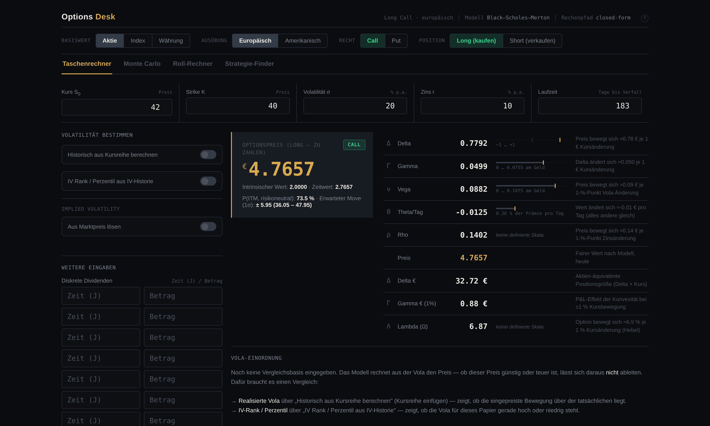
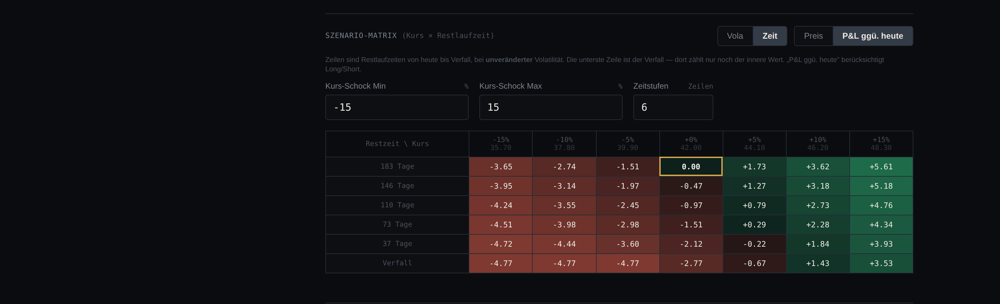

# Options Desk

**Ein Options-Pricing-Terminal im Browser — eine einzige HTML-Datei, kein Build, kein Server, keine Abhängigkeiten.**

🔗 **[Live öffnen](https://USERNAME.github.io/options-desk/)**

> **Privates Lernprojekt.** Keine Anlageberatung, keine Handelsempfehlung, keine Gewähr für die
> Richtigkeit der Ergebnisse — siehe [Haftungsausschluss](#haftungsausschluss).



---

*A browser-based options pricing terminal. Black-Scholes-Merton and Cox-Ross-Rubinstein binomial pricing, full first- and second-order Greeks on calibrated scales, implied-volatility solver, volatility-premium analysis, scenario matrices across price × vol and price × time, Monte Carlo, a roll calculator and a strategy finder. One self-contained HTML file, ~4,600 lines, no build step. UI language: German.*

---

## Der Grundgedanke

Die meisten kostenlosen Optionsrechner geben einen Preis und fünf Greeks aus. Das beantwortet die Frage „was ist diese Option wert" — aber nicht die Frage, die beim Handeln zählt: **Ist dieser Preis gut, und was passiert mit meiner Position, wenn sich nichts bewegt?**

Dieses Tool deckt den ganzen Weg ab: bewerten, Risiko verstehen, Vola einordnen, Struktur auswählen, Position dimensionieren, Rollen durchrechnen.

---

## Taschenrechner

### Bewertung

| | |
|---|---|
| **Modelle** | Black-Scholes-Merton (europäisch, geschlossene Form) · Cox-Ross-Rubinstein-Binomialbaum (amerikanisch, inkl. vorzeitiger Ausübung) |
| **Greeks 1. Ordnung** | Delta, Gamma, Vega, Theta, Rho — zusätzlich in Währungseinheiten (Delta €, Gamma € bei 1 % Bewegung) |
| **Greeks 2. Ordnung** | Vanna, Charm, Vomma (finite Differenzen auf den analytischen Greeks) |
| **Hebel** | Lambda / Omega (Elastizität) |
| **Implied Vol** | Newton-Raphson auf BSM-Vega, Bisektion als Rückfall und für den Baum |
| **Dividenden** | Bis zu 7 diskrete Dividenden nach der Escrowed-Dividend-Methode (S − Barwert der Dividenden) |
| **Basiswerte** | Aktie, Index, Währung (Garman-Kohlhagen über q = Auslandszins) |
| **Wahrscheinlichkeiten** | P(ITM) risikoneutral, erwarteter Move (1σ / 2σ), Berührungswahrscheinlichkeit über das Reflexionsprinzip |
| **Vorzeitige Ausübung** | Ausübungsgrenze numerisch bestimmt, mit Merton-Kurzschluss (Calls ohne Dividende werden nie vorzeitig ausgeübt) |

### Greeks auf echten Skalen

Jeder Greek steht neben einem Balken, der zeigt, **wo er innerhalb seines tatsächlichen Wertebereichs liegt** — aber nur dort, wo dieser Bereich definiert ist:

- **Delta** auf −1 bis +1
- **Gamma** und **Vega** auf 0 bis zu ihrem Maximum am Geld, das bei gleichen Parametern über dem Kurs gesucht wird
- **Theta** normiert auf die Prämie selbst: „0,26 % der Prämie pro Tag" statt einer nackten Zahl
- **Rho** und **Lambda** bekommen **keinen** Balken, weil es für sie keinen definierten Bereich gibt

Eine Anzeige, die Rho auf „60 % von irgendwas" setzt, täuscht eine Messung vor, die nicht existiert. Die frühere Version tat genau das; die Entscheidung dagegen ist bewusst getroffen.

### Farbe bedeutet eine Sache

Grün und Rot sind im ganzen Tool **Geldbeträgen** vorbehalten — P&L, Netto-Cashflow, Erwartungswert, Max Gewinn und Verlust. Greeks stehen neutral. Ein positives Vega ist nicht „gut"; ob es nützt, hängt an einer Vola-Erwartung, die das Modell nicht kennt.

### Vola-Einordnung

Der Teil, der über reines Rechnen hinausgeht. Gibt man die implizite Vola aus der Optionskette ein, liefert das Modell per Konstruktion den Marktpreis zurück — aus dem Preis allein lässt sich deshalb **nie** ableiten, ob eine Option teuer ist. Die Aussage muss aus der Vola kommen:

```
Eingesetzte Vola (σ)     12.26 %   manuell gesetzt
Realisierte Vola (HV)    10.33 %   σ liegt 18.7 % darüber — Verhältnis 1.19
IV Rank                     52     Lage zwischen Tief und Hoch der Periode
IV Perzentil                60     mittleres Drittel der eigenen Spanne
──────────────────────────────────────────────────────────────
Bewertet mit σ = 12.26 %   5.4905 €
Bewertet mit HV = 10.33 %  4.8331 €
Vola-Aufschlag            +0.6575 €   12.0 % der Prämie
```

Dieselbe Bewertung zweimal — einmal mit der eingepreisten, einmal mit der tatsächlich realisierten Bewegung. Die Differenz ist der Vola-Aufschlag in Euro. Der Satz darunter dreht sich mit der Position: Als Käufer zahlst du ihn, als Stillhalter vereinnahmst du ihn.

**Bewusst ohne Ampel.** Die implizite Vola liegt strukturell über der realisierten — das ist die Volatilitätsrisikoprämie und für sich kein Fehlpreis. Ein Verhältnis von 1,2 ist bei einem breiten ETF normal und bei einer Einzelaktie vor Zahlen niedrig. Eine feste Schwelle wäre bei ETFs fast immer rot und damit wertlos. Das Tool zeigt die Zahlen und überlässt das Urteil dem Nutzer.

### Szenario-Matrizen

Zwei Achsen zur Wahl, jeweils als Preis oder als P&L gegenüber heute:

- **Kurs × Vola** — was ein Volatilitätsschock anrichtet
- **Kurs × Restlaufzeit** — was passiert, wenn der Kurs stillsteht und nur Zeit vergeht



Die zweite ist die Frage, die beim Halten täglich zählt. In der Spalte ±0 % liest man den Zeitwertverfall direkt ab; die unterste Zeile zeigt, ab wo weiteres Fallen nichts mehr kostet. Dividenden werden dabei korrekt mitgeführt: bereits gezahlte fallen weg, die übrigen rücken näher.

### Visualisierung

Sensitivitäts-Chart (jede Eingangsgröße gegen jeden Greek), 3D-Vola-Oberfläche (Three.js), P&L-Diagramm mit Zeitregler von heute bis Verfall, erwartete Kurszonen (±1σ, ±2σ) als Overlay, GEX-Profil über die Optionskette.

---

## Multi-Leg-Strategien

Bis zu vier Options-Legs plus ein Aktien-Leg. Aggregierte Greeks, Break-even-Punkte, Max Gewinn und Verlust, Szenario-Matrix.

Abgebildet: Spreads (Bull/Bear, Call/Put), Straddle, Strangle, Butterfly, Iron Condor, Covered Call, Cash-Secured Put, Collar, **Calendar- und Diagonal-Spreads** mit verschiedenen Laufzeiten je Leg (damit auch PMCC), Wheel, Strap/Strip.

Long und Short ziehen sich durchgängig durch Preis, Greeks, P&L, Szenarien und Positionsgröße.

## Monte Carlo

Terminalpreis-Simulation über Box-Muller-Normalsampling, direkt lognormal gezogen — exakt für europäische Terminal-Payoffs, nicht pfad-diskretisiert. Ausgabe: Verteilung des Endpreises, P&L-Histogramm, Erfolgswahrscheinlichkeit, Erwartungswert, Median, 5 %-VaR.

## Roll-Rechner

Bestehende gegen neue Position: Greeks, Netto-Credit oder -Debit, Veränderung von Break-even und Kapitalbindung. Die implizite Vola wird aus den eingegebenen Marktpreisen gelöst, statt für beide Seiten dieselbe Vola zu unterstellen — Strikes haben durch den Skew unterschiedliche IV.

## Strategie-Finder

Eingabe ist eine *Meinung* — Kursziel, Zeithorizont, Überzeugungsgrad, Kapitalrahmen. Ausgabe sind passende Strukturen, sortiert nach Erwartungswert, Erfolgswahrscheinlichkeit oder Chance-Risiko-Verhältnis.

Die Bewertung läuft über die **subjektive** Verteilung des Nutzers (Median = Kursziel, Streuung skaliert mit der Überzeugung), nicht über das risikoneutrale Maß — sonst wäre der Erwartungswert jeder Struktur per Konstruktion ungefähr null. Der Abstand zum markt-impliziten Forward wird ausgewiesen, damit sichtbar bleibt, wie stark die eigene Meinung vom eingepreisten Pfad abweicht.

Gefiltert auf das, was mit einem Cash-Konto und IBKR-Optionslevel 3 handelbar ist.

## Risiko und Positionsgröße

Kelly-Kriterium (f = p − q/b), prozentuales Risiko je Trade, Gamma-Exposure-Profil (GEX) über die Kette.

---

## Technische Umsetzung

- **Eine Datei.** `index.html`, ~4.600 Zeilen, 222 KB. HTML, CSS und JavaScript inline. Per Doppelklick lokal lauffähig, auch offline — nur die 3D-Oberfläche lädt Three.js vom CDN.
- **Kein Framework, kein Build.** Vanilla JS, Charts als handgeschriebenes SVG. Null Canvas, deshalb lässt sich die gesamte Darstellung über CSS-Variablen umfärben.
- **Genauigkeit vor Bequemlichkeit.** Die Laufzeit wird in Tagen eingegeben und als `Tage/365` gerechnet, nicht auf glatte Jahre gerundet. Ein halbes Jahr sind 183 Tage, also 0,501370 Jahre.
- **Numerische Robustheit.** Überlaufschutz bei der Berührungswahrscheinlichkeit (der Exponent skaliert mit 1/σ² und läuft schon bei moderat niedriger Vola über), absolute statt relativer Toleranz bei der Ausübungsgrenze, globales `min-width:0` gegen das Überlaufverhalten von Eingabefeldern im CSS-Grid.
- **Performance.** Die Optionskette löst die implizite Vola je Zeile. Nach Profiling von 80 auf 30 Bisektions-Iterationen reduziert (30 liefern bereits ~5e-9 Präzision) und die Baumschritte gedeckelt: Worst Case von 1,5–2,4 s auf ~325 ms, Genauigkeitsverlust 0,0001 Vola-Punkte.
- **Gestaltung.** Trennung über Haarlinien und Ausrichtung statt über verschachtelte Kästen, drei Schriftgrößen, Kopfbereich auf eine 32px-Statuszeile reduziert.

## Validierung

Gegen Lehrbuchwerte (Hull), Put-Call-Parität, Greek-Identitäten per finiter Differenz und die Konvergenz Baum → BSM geprüft; jede Zelle der Szenario-Matrizen gegen eine unabhängige Rechnung gehalten.

Gegen eine reale IBKR-Position: TLT, Verfall Dezember 2026, Strike 83 — gelöste IV **12,33 %** gegen die vom Broker ausgewiesenen **12,262 %**, also 0,07 Prozentpunkte Abweichung. Delta und Gamma innerhalb von 3,5 %.

## Nutzung

Live über den Link oben, oder `index.html` herunterladen und doppelklicken. Es werden keine Daten gesendet oder gespeichert; alles läuft lokal im Browser.

## In Arbeit

- **Optionsketten-Import** — Kette aus TWS einfügen oder als CSV einlesen, statt Strikes von Hand einzutragen. Braucht zusätzlich eine Anzeige, die nur die sichtbaren Zeilen löst, damit eine Kette mit 60+ Strikes nicht bei jeder Änderung neu rechnet. Beispieldateien im Repository enthalten ausschließlich erfundene Zahlen — echte Marktdaten werden hier nicht abgelegt (siehe `.gitignore`).
- **Druckbare Bewertungsnotiz** — die aktuelle Bewertung als gesetzte Analystennotiz mit Tabellen, Abbildung und Annahmen.
- **Synthetischer Backtest** — eine Strategie über historische Kursreihen laufen lassen.

## Grenzen

Keine Live-Marktdaten, Eingaben sind manuell. Die Greeks 2. Ordnung sind auch im amerikanischen Modus BSM-Näherungen. Die Modelle unterstellen konstante Volatilität und keine Sprünge; reale Preise weichen durch Skew, Zinsstruktur, Dividenden und Geld-Brief-Spanne ab.

## Haftungsausschluss

Dieses Projekt ist ein **privates Lernprojekt**. Es dient der Bewertung und Analyse von Standardoptionen zu Ausbildungs- und Demonstrationszwecken.

Es stellt **keine Anlageberatung, keine Anlagevermittlung und keine Handelsempfehlung** dar. Die ausgegebenen Werte sind Modellergebnisse auf Basis der vom Nutzer selbst eingegebenen Parameter und können von realen Marktpreisen erheblich abweichen. Es wird keine Gewähr für Richtigkeit, Vollständigkeit oder Aktualität übernommen.

Die Rangliste im Strategie-Finder folgt ausschließlich den Annahmen, die der Nutzer selbst eingibt. Sie ist eine Rechenauskunft, keine Empfehlung.

Optionsgeschäfte sind mit erheblichen Risiken verbunden und können zum Totalverlust des eingesetzten Kapitals führen; bei Stillhalterpositionen sind Verluste darüber hinaus möglich. Die Nutzung erfolgt auf eigenes Risiko. Für Haftungsfragen gilt ergänzend der Gewährleistungsausschluss der MIT-Lizenz.

## Verwendete Fremdkomponenten

| Komponente | Lizenz | Einbindung |
|---|---|---|
| [Three.js](https://threejs.org) r128 | MIT | über cdnjs, nur für die 3D-Vola-Oberfläche |
| [Space Grotesk](https://fonts.google.com/specimen/Space+Grotesk) | SIL Open Font License 1.1 | über Google Fonts |
| [IBM Plex Mono](https://fonts.google.com/specimen/IBM+Plex+Mono) | SIL Open Font License 1.1 | über Google Fonts |

Alle drei werden zur Laufzeit geladen und nicht mit diesem Repository verbreitet. Ohne Netzverbindung läuft der Rechner weiterhin vollständig; nur die 3D-Oberfläche und die Schriften fallen auf Systemvorgaben zurück.

## Datenverarbeitung

Das Tool selbst verarbeitet keine personenbezogenen Daten: Es sendet nichts an einen Server, setzt keine Cookies und speichert keine Eingaben. Alle Berechnungen laufen im Browser des Nutzers.

Die Auslieferung erfolgt über GitHub Pages (GitHub, Inc.). Beim Abruf der Seite werden durch GitHub serverseitig Verbindungsdaten einschließlich der IP-Adresse verarbeitet, worauf der Betreiber dieses Repositories keinen Einfluss hat. Die Schriftarten werden von Google Fonts und die 3D-Bibliothek von cdnjs (Cloudflare) geladen; dabei wird die IP-Adresse an den jeweiligen Anbieter übermittelt. Siehe die Datenschutzhinweise von [GitHub](https://docs.github.com/en/site-policy/privacy-policies/github-general-privacy-statement), [Google](https://policies.google.com/privacy) und [Cloudflare](https://www.cloudflare.com/privacypolicy/).

## Lizenz

MIT — siehe [LICENSE](LICENSE).
